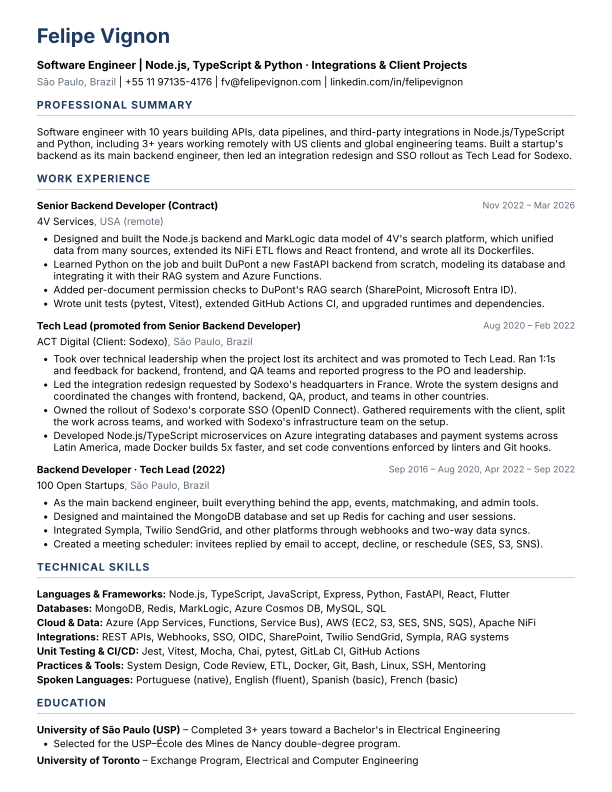
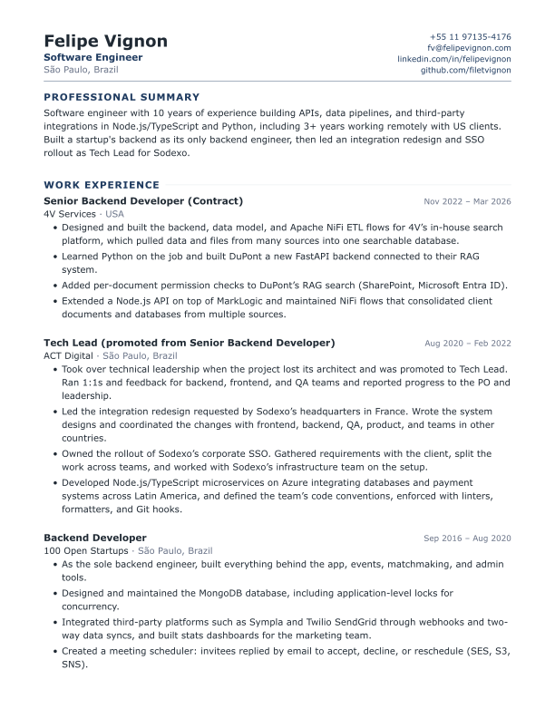
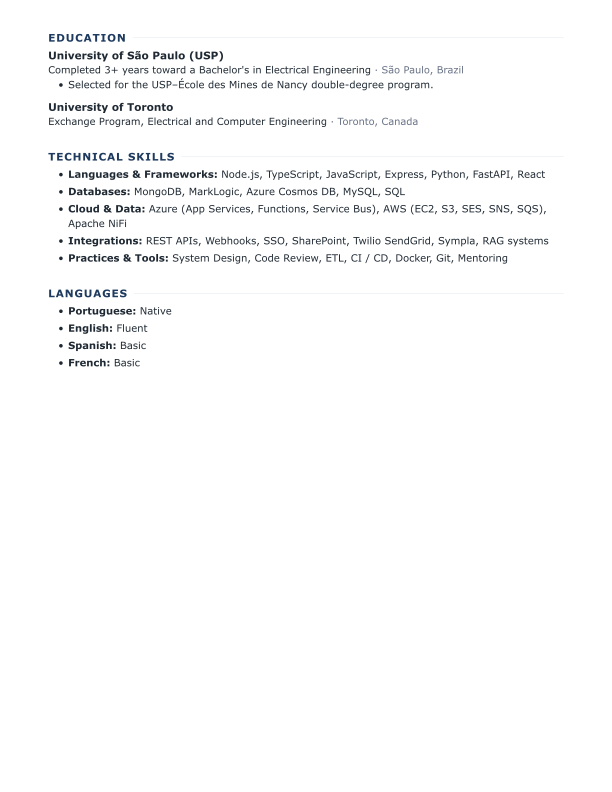
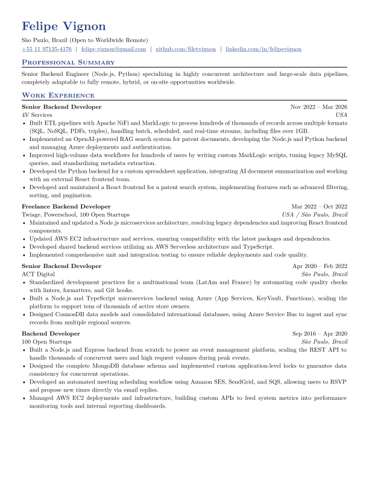
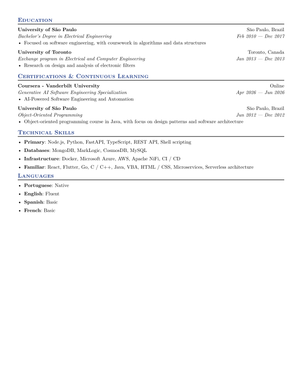
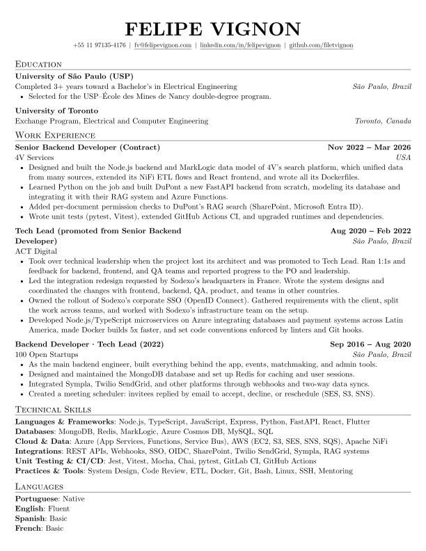
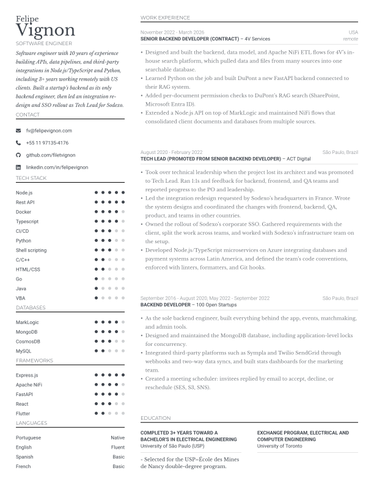

# CV in Typst

## Git Hooks

This repository tracks hooks in `.githooks/`.

After cloning, run:

```bash
git config core.hooksPath .githooks
```

The `pre-push` hook compiles all templates in english and portuguese, stages compiled files, and amends the latest commit if any files have changed.

## Previews

### Clean (recommended)

Custom single-column, one-page template built for ATS parsing. Uses the bundled Inter font in `fonts/`
(passed by `compile.sh` via `--font-path fonts`), so it renders identically on any machine.



### Modernpro

<https://github.com/jxpeng98/Typst-CV-Resume>




### StephenXu

<https://github.com/stuxf/basic-typst-resume-template>




### Technical

<https://github.com/steadyfall/simple-technical-resume-template>




### Typographic

<https://github.com/tsnobip/typst-typographic-resume>



## Other templates

- <https://github.com/roaldarbol/academicv>
