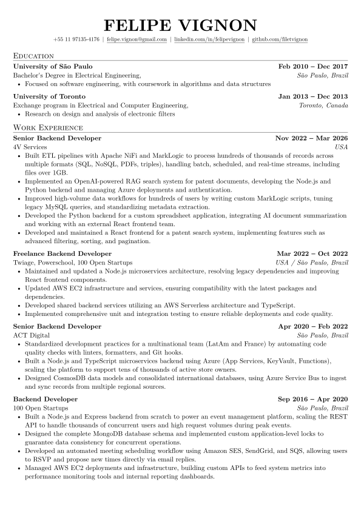

# CV in Typst

<https://github.com/tsnobip/typst-typographic-resume>
<https://github.com/roaldarbol/academicv>

## Git Hooks

This repository tracks hooks in `.githooks/`.

After cloning, run:

```bash
git config core.hooksPath .githooks
```

The `pre-push` hook compiles all templates in english and portuguese, stages compiled files, and amends the latest commit if any files have changed.

## Previews

### Modernpro


### StephenXu


### Basic



